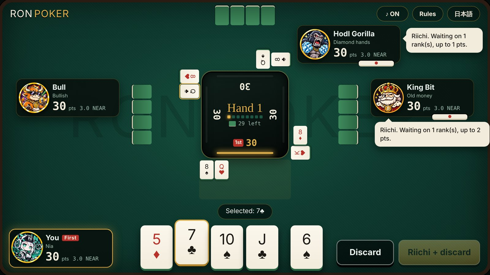
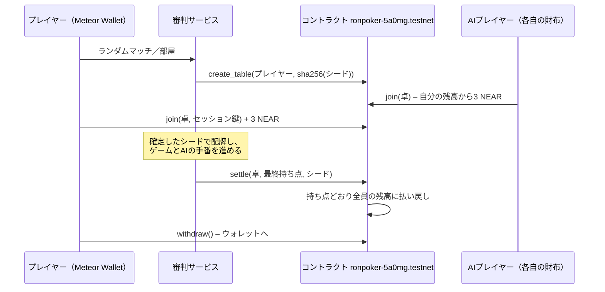

# Ron Poker（ロンポーカー）

**麻雀のルールで、ポーカーの役をつくる。NEARテストネットで本当に賭けて遊べる4人対戦カードゲーム。**

麻雀のように1枚引いて1枚捨て、5枚でポーカーの役ができたら上がり。あと1枚で上がれるときは**リーチ**、自分で引いて上がれば**ツモ**、他人の捨て札で上がれば**ロン**。参加費は1人3テストネットNEAR。スマートコントラクトが参加費を預かり、ゲームが終わった瞬間に持ち点どおり払い戻します。空いた席には、それぞれ自分のテストネット財布を持つAIプレイヤー3人が座り、自分の財布から参加費を払います。

English → [README.md](README.md)



| | |
|---|---|
| 遊ぶ | **https://ponkotsuai.github.io/ron-poker/**（PCブラウザ、またはスマホ横向き） |
| コントラクト | [`ronpoker-5a0mg.testnet`](https://testnet.nearblocks.io/address/ronpoker-5a0mg.testnet)（Rust, near-sdk 5） |
| 審判サービス | https://ron-poker-referee.onrender.com/health |
| トラック | Games With Real Economies |

---

## 試し方

### 1. 1分で練習（ウォレット不要）

1. https://ponkotsuai.github.io/ron-poker/ を開き、タイトル画面の **PLAY** を押す。キャラを選んで **練習モード（ウォレットなし）** を押す。
   → 「第1局」の帯が出て、手札が4枚配られ、中央パネルに全員の持ち点が表示される。
2. 中央パネルの金色のランプが自分を指したら、5枚目を引いた状態。カードを選んで **捨てる**（またはダブルクリック）。
   → カードが自分の捨て札の列に落ちる。**R** マークのカードは、それを捨てるとあと1枚で上がれる状態になる印。
3. **R** のカードを選んで **リーチして捨てる** を押す。
   → 赤い墨の「リーチ」カットインが出て、名札の下にリーチ棒が置かれる。以後は手札が固定される。
4. 誰かが上がるまで続ける。
   → 「ロン」か「ツモ」のカットイン、上がった人へチップが飛び、結果画面に役・点数・全員の増減が出る。
5. 対戦相手の吹き出しを見る。
   → 「リーチが入った。ジョーカーを安全牌として切る。」のように、打った理由をしゃべる。

言語の切り替え（English／日本語）は、タイトル画面の **設定** と、メニュー・卓の右上にあります。

### 2. テストネットNEARで遊ぶ

**テストネット**に切り替えた [Meteor Wallet](https://wallet.meteorwallet.app/) と、3.1 NEAR程度の残高が必要です。

1. ゲームを開いて **PLAY** を押し、キャラを選び、ニックネームを入れて（任意）**NEARテストネットで遊ぶ** を押し、Meteorでサインインを承認する。
   → ロビーに自分のアカウントと、コントラクト内の自分の残高（卓の財布）が表示される。
   → 審判サービスは無料サーバーで動いているため、しばらく使われていないと起動に最大1分ほどかかる。
2. **ランダムマッチ** を押す。15秒以内に他の人が来なければ、空席にAIが座る。
   → 「審判がチェーン上に卓 #N を開き、シャッフルのシードを確定しました。」と、エクスプローラーへの `tx ↗` リンク。
   → AIごとに「ドン・ホエールが自分の財布から参加費3 NEARを払いました。」
3. **参加費3 NEARを払う** を押し、Meteorで承認する。
   → 4人全員の参加費がそろうとカードが配られる。
4. 8局（または誰かが0点になるまで）打つ。
   → 最終画面に「卓 #N を精算しました。コントラクトが持ち点どおりに払い戻しました。」と精算トランザクション。NearBlocksで開くと、`settle` の呼び出しに最終持ち点と、公開されたシャッフルのシードが入っている。
5. 勝った分はコントラクト内の自分の残高に入る。**もう一度遊ぶ** でロビーに戻る。
   → 残高が3 NEAR以上あれば、ボタンが **残高の3 NEARで参加する** に変わり、新しくNEARを送らずに参加できる。
6. 最終画面の **ウォレットに引き出す** を押すと、残高をまとめて自分のウォレットに戻せる。

### ランキング

タイトル画面の **Ranking** を押す。
→ テストネットで精算まで終えたウォレットが、増減したNEARの合計順に並ぶ（対戦数・1位回数・平均順位つき）。審判がコントラクトの卓の記録（`get_table`）を全部読んで集計しているので、チェーンの記録と一致する。AIの財布には **AI** マーク。表示名はニックネーム、なければアカウントの最初と最後の5文字。

### 3. 友達と遊ぶ

1. ロビーで **部屋を作る** を押す。
   → 4文字の部屋コードが出る。
2. 友達がゲームを開いてウォレットをつなぎ、コードを入れて **入室** を押す。
   → お互いが部屋のメンバーとして表示される。
3. 部屋を作った人が **2人で開始（空席はAI）** を押す。空席にはAIが座り、人間はそれぞれ上と同じように参加費を払う。

途中で回線が切れた人の席は、戻ってくるまで安全な手で自動的に打ち続けるので、卓は必ず最後まで進んで精算されます。

### 4. 手元のPCで全部動かす（ウォレット・テストネット不要）

Node 20以上が必要です。

```bash
git clone https://github.com/ponkotsuai/ron-poker.git
cd ron-poker
npm ci
npm run build
npm run referee:offline   # 審判を http://localhost:8787 で起動（チェーンはメモリ上の模擬）
npm run serve             # 別のターミナルで：ゲームを http://localhost:8765 で配信
```

http://localhost:8765/?referee=http://localhost:8787&testAccount=judge.testnet を開き、**PLAY** → **NEARテストネットで遊ぶ** → **ランダムマッチ** → **参加費3 NEARを払う** の順に押す。
→ ウォレットのポップアップなしで、模擬コントラクト相手に同じ流れが動く。`testAccount=friend.testnet` の2つ目のタブを開けば、2人で部屋機能も試せる。

### 5. テストを動かす

```bash
npm test                      # ルールエンジン＋審判サーバー（ランダムマッチ、部屋、途中退出）
npm run simulate -- 200       # AIだけで200ゲーム：速さ、役の出やすさ、バランス
cd contract && cargo test     # コントラクトの単体テスト15件
```

---

## お金の仕組み



- **胴元なし。** 1点＝0.1 NEAR。全員30点（＝参加費3 NEAR）から始まり、点数はプレイヤー間を動くだけなので、4人の払い戻しの合計はいつも預かった額と同じ。合計が120点にならない結果は、コントラクトが受け付けない。
- **負けた人が支払いを止められない。** 結果は審判が報告し、コントラクトがその場で払い戻す。誰かの署名を待つ必要はない。
- **審判はお金を持ち出せない。** できるのは、卓を開く・合計が合う結果で精算する・全額返金で卓を取り消す、の3つだけ。
- **配牌は先に決まっている。** シャッフルのシードは卓を開くときにハッシュ（sha256）で確定し、`settle` で公開される。最初の1枚が配られる前に山の並びが決まっていたことを、誰でも確かめられる。
- **審判が消えても返金される。** 待機中の卓はいつでも、プレイ中の卓は1時間たてば、席のプレイヤー本人が取り消して参加費を取り戻せる。
- **損は参加費まで。** 持ち点より多く払うことになった人は、持っている分だけ払って0点で止まる。誰かが0点になった時点でゲーム終了。
- **AIの財布は鍵が制限されている。** 各AIは `join` と `abort` しか呼べない鍵で打つ。`withdraw` には1 yoctoNEARの添付が必要で、この種類の鍵では添付できないため、AIの打牌用の鍵でNEARを持ち出すことはできない。
- **自分の席は自分だけのもの。** 参加費を払うときに使い捨てのセッション鍵を登録し、ブラウザがその鍵で署名して、自分の席を打っていることを審判に証明する。

| コントラクトのメソッド | 呼べる人 | 内容 |
|---|---|---|
| `deposit()` | 誰でも | 添付したNEARを自分の残高に入れる |
| `join(table_id, session_key?)` | 席のプレイヤー | 添付したNEARか自分の残高から参加費を払う |
| `settle(table_id, points, seed)` | 審判 | 持ち点どおりに払い戻し、シードを公開 |
| `abort(table_id)` | 審判／プレイヤー | 取り消して全額返金（プレイヤーは待機中か、タイムアウト後のみ） |
| `withdraw(amount?)` | 本人（1 yocto） | 残高をウォレットに戻す |
| `bankroll_of`, `get_table`, `get_config` | 閲覧 | 状態を読む |

---

## ルール（短縮版）

- トランプ52枚＋ジョーカー2枚。手札は各4枚。自分の番に1枚引き、5枚で**スリーカード以上**なら上がり。
- **リーチ**：手札4枚があと1枚で上がれる状態なら宣言できる。手札は固定。他人の捨て札で**ロン**できるのはリーチした人だけ。**ツモ**（自分で引いて上がる）は誰でもできる。
- **フリテン**：その局で自分が捨てた数字では、ロンできない。
- **ジョーカー**はワイルドではない。上がり手に入っていれば点数2倍（2枚なら4倍）。ジョーカーでは誰もロンできないので、安全な捨て札にもなる。
- ロン：捨てた人が点数×3を払う。ツモ：他の3人が点数×1ずつ払う。
- 1ゲーム8局、または誰かが0点で終了。**先手**の人から局が始まり、先手は局ごとに隣へ移る。

| 役 | 点数 |
|---|---|
| スリーカード | 1 |
| ストレート | 2 |
| フラッシュ | 3 |
| フルハウス | 4 |
| フォーカード | 10 |
| ストレートフラッシュ | 20 |
| ロイヤルストレートフラッシュ | 50 |

## キャラクター

スタート画面で10キャラから1人を選びます。CPUは残りの9キャラから選ばれます。各キャラにはメイン画像と喜怒哀楽の表情があり、上がると笑い、ロンされると怒り、支払ったり点数が減ると泣き、トップやリーチ中はニヤリとします。

CPUはルールベースのAI（LLMではありません）。まだ見えていないカードから2手先まで読み、リーチした人に対して各捨て札がどれだけ危ないかを見積もり、上がりの速さと点数の高さを天秤にかけます。キャラごとに傾向が違います。

| キャラ | タイプ | 打ち方 |
|---|---|---|
| ビット王 | 古参の大富豪 | 我慢強く、リードを守る |
| ドン・ホエール | 大口 | 高い役を狙う。スリーカードでは上がらない |
| ガチホ💎ゴリラ | ダイヤの手 | 絶対に降りない。ジョーカーも絶対に捨てない |
| シバイーヌ | スピード狂 | 安くても早く上がる |
| エスラ | 計算魔 | 危ない札は決して切らない |
| ニア | オールラウンダー | バランス型。NEARの看板娘 |
| ペペロン | ハッタリ | 欲張りで押していく |
| ブルド | 超強気 | リーチが来ても押す |
| ベアリー | 超弱気 | 危なければすぐ降りる |
| ラギー | ラグプル | ツモでは上がらず、ロンだけを狙う。点数の増減に2倍敏感 |

全員、卓に残った持ち点（＝NEAR）で気分が変わり、なぜその手を打ったかを吹き出しでしゃべります。テストネットでは、審判が持つ3つのAI財布が、その卓で誰も選んでいないキャラとして座ります。

## リポジトリ構成

| パス | 内容 |
|---|---|
| `js/engine.js` | ルール本体：山札、役判定、待ち、フリテン、支払い |
| `js/game.js` | 1ゲームの進行：手番、リーチ、ロンの優先順、イベント |
| `js/ai.js` | AIプレイヤーと性格 |
| `js/main.js`, `css/style.css`, `js/fx.js` | 卓の画面、カットイン、効果音（Web Audioで合成、素材ファイルなし） |
| `js/chain.js`, `js/config.js` | Meteor Wallet、コントラクト呼び出し、審判との接続 |
| `server/` | 審判サービス（Node＋WebSocket）：ロビー、部屋、配牌、AIの財布、精算 |
| `contract/` | Rustのコントラクトとテスト（`build.sh` でwasmをビルド） |
| `scripts/` | ビルド、ローカル配信、オフライン審判、シミュレーション |

## 制限

- **テストネット限定。** 本物のお金を賭けると、開発した日本では賭博にあたるため、メインネットのNEARは一切扱いません。
- **ゲームの進行は審判を信頼する形。** 手札を隠すには配る役が必要なので、審判はカードを見ています。ただし、参加費を持ち出すこと、確定後に山を入れ替えること、参加費を返さないことはできません（結果の合計チェック、シードの照合、タイムアウト後の返金）。
- 審判サービスは無料のRenderで動いているため、起動に最大1分ほどかかることがあります。

## クレジット

- 台詞音声：VOICEVOXで作成。VOICEVOX:ちび式じい、VOICEVOX:青山龍星、VOICEVOX:玄野武宏、VOICEVOX:ずんだもん、VOICEVOX:四国めたん、VOICEVOX:琴詠ニア、VOICEVOX:剣崎雌雄、VOICEVOX:白上虎太郎、VOICEVOX:雀松朱司（どのキャラがどの声かは `assets/voice/CREDITS.txt`）
- BGM：Ron Poker用に作ったオリジナルのラウンジ曲（`assets/bgm.mp3`）
- 効果音：ブラウザのWeb Audio APIで合成
