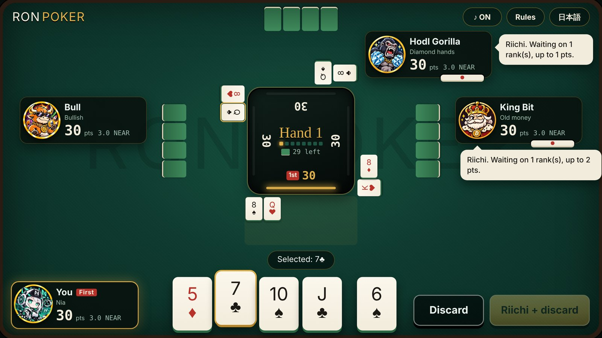
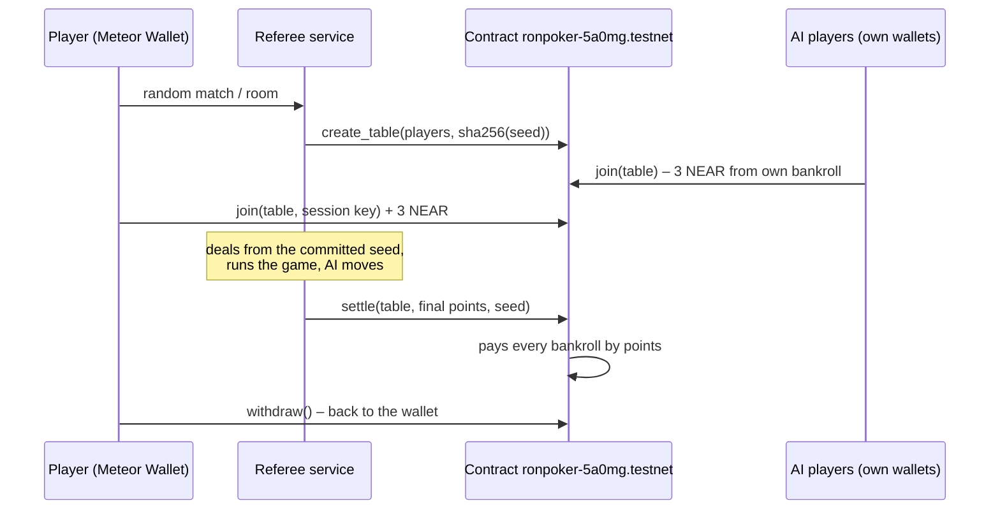

# Ron Poker

**Mahjong rules, poker hands, real stakes on NEAR testnet.**

Four players draw and discard like in mahjong, but the winning hand is a poker hand. You declare *riichi* when you are one card away, and you win on your own draw (*tsumo*) or on someone else's discard (*ron*). Every seat buys in with 3 testnet NEAR. A smart contract holds the pot and pays it out by final points the moment the game ends. Empty seats are filled by three AI players, each with its own testnet wallet that pays its own buy-in.

日本語版 → [README.ja.md](README.ja.md)



| | |
|---|---|
| Play | **https://ponkotsuai.github.io/ron-poker/** (PC browser, or a phone held sideways) |
| Contract | [`ronpoker-5a0mg.testnet`](https://testnet.nearblocks.io/address/ronpoker-5a0mg.testnet) (Rust, near-sdk 5) |
| Referee service | https://ron-poker-referee.onrender.com/health |
| Track | Games With Real Economies |

---

## Try it

### 1. Practice in one minute (no wallet)

1. Open https://ponkotsuai.github.io/ron-poker/ and press **PLAY** on the title screen. Pick a character, then press **Practice (no wallet)**.
   → A "Hand 1" banner plays, four cards are dealt to you, and the centre panel shows each seat's points.
2. When the gold light in the centre panel points at you, you have drawn a fifth card. Click a card, then **Discard** (or double-click it).
   → The card drops into your discard row. A card marked **R** means you would be one card from winning without it.
3. Pick an **R** card and press **Riichi + discard**.
   → A red brush-stroke "リーチ" cut-in plays, a riichi stick appears under your nameplate and 1 point moves into the **Pot** in the centre panel. Your hand is now locked.
4. When an opponent declares riichi, a **Fold (1 pt)** button appears above Discard. Tap it twice to sit the hand out.
   → Your nameplate turns grey with a FOLD tag. Nobody can ron you this hand.
5. Keep going until someone wins.
   → A "ロン" or "ツモ" cut-in, chips fly to the winner, and the result sheet shows the hand, its points and everyone's change.
6. Watch the opponents' speech bubbles.
   → They explain their decisions, for example "Riichi on the table. The joker is my safe throw."

The language switch (English / 日本語) is under **Settings** on the title screen, and at the top right of the menu and the table.

### 2. Play for testnet NEAR

You need [Meteor Wallet](https://wallet.meteorwallet.app/) on **testnet** with at least about 3.1 NEAR.

1. Open the game, press **PLAY**, pick a character, optionally type a nickname, and press **Play on NEAR testnet**. Approve the sign-in in Meteor.
   → The lobby shows your account and your table bankroll inside the contract.
   → The referee runs on a free server: the first visit after a quiet period can take up to a minute to wake it.
2. Press **Random match**. If nobody else joins within 15 seconds, the three AI players take the empty seats.
   → "The referee opened table #N on chain and committed the shuffle seed", with a `tx ↗` link to the explorer.
   → One line per AI: "Don Whale paid the 3 NEAR buy-in from its own bankroll."
3. Press **Pay 3 NEAR buy-in** and approve in Meteor.
   → Once all four buy-ins are in, the cards are dealt.
4. Play the 8 hands (or until someone reaches 0 points).
   → The final sheet says "Table #N settled: the contract paid the pot out by points", with the settle transaction. Open it on NearBlocks: the `settle` call carries the final points and reveals the shuffle seed.
5. Your winnings stay in your bankroll inside the contract. Press **Play again** to go back to the lobby.
   → With 3 NEAR or more in the bankroll, the pay button becomes **Join with 3 NEAR from your bankroll**: no new NEAR is sent.
6. Or press **Cash out to wallet** on the final sheet to move the whole bankroll back to your wallet.

### Ranking

Press **Ranking** on the title screen.
→ Every wallet that has played a settled testnet table, ranked by total NEAR won or lost, with games, first places and average place. The referee builds it by reading every table from the contract (`get_table`), so it matches the chain. AI wallets are tagged **AI**. Players show their nickname, or their account shortened to the first and last five characters.

### 3. Play with a friend

1. In the lobby, press **Create a room**.
   → You get a 4-letter room code.
2. Your friend opens the game, connects a wallet, types the code and presses **Join**.
   → Both of you see each other in the room.
3. The host presses **Start with 2 (AI fills the rest)**. Empty seats are filled by AI players, and each human pays the buy-in as above.

If a human disconnects mid-game, their seat keeps playing safe default moves until they come back, so the table always finishes and settles.

### 4. Run everything locally (no wallet, no testnet)

Node 20 or later.

```bash
git clone https://github.com/ponkotsuai/ron-poker.git
cd ron-poker
npm ci
npm run build
npm run referee:offline   # referee on http://localhost:8787 with an in-memory chain
npm run serve             # in a second terminal: the game on http://localhost:8765
```

Open http://localhost:8765/?referee=http://localhost:8787&testAccount=judge.testnet, press **PLAY**, then **Play on NEAR testnet**, **Random match** and **Pay 3 NEAR buy-in**.
→ The same on-chain flow runs against a simulated contract, without wallet pop-ups. Open a second tab with `testAccount=friend.testnet` to try rooms with two players.

### 5. Run the tests

```bash
npm test                      # rules engine + referee server (quick match, rooms, leaving mid-game)
npm run simulate -- 200       # 200 AI-only games: speed, hand frequencies, balance
cd contract && cargo test     # 15 contract unit tests
```

---

## How the money works



- **No house.** 1 point = 0.1 NEAR. Everyone starts with 30 points (= the 3 NEAR buy-in), and points only move between players, so the four payouts always add up to the pot. The contract rejects any result whose points do not add up to 120.
- **Losers cannot stall the payout.** The referee reports the result and the contract pays at once. Nobody has to sign off.
- **The referee cannot take money.** It can only open tables, settle a pot that adds up, or cancel a table with a full refund.
- **A fixed deal.** The shuffle seed is committed (sha256) when the table opens and revealed in `settle`, so anyone can check that the deck order was set before the first card.
- **Way out if the referee disappears.** Any player can cancel a waiting table, or a table in play after one hour, and every buy-in is refunded.
- **The most you can lose is your buy-in.** A player who owes more points than they have pays what they have and stops at 0. The game ends when anyone reaches 0.
- **AI wallets are locked down.** Each AI account plays with a function-call key that can only `join` and `abort`. `withdraw` needs a 1 yoctoNEAR deposit, which such a key cannot attach, so the playing key can never move NEAR out.
- **Your seat is yours.** When you pay, you register a one-off session key. Your browser signs with it to prove to the referee that it plays your seat.

| Contract method | Who | What it does |
|---|---|---|
| `deposit()` | anyone | add attached NEAR to your bankroll |
| `join(table_id, session_key?)` | seated player | buy in from the attached deposit or from your bankroll |
| `settle(table_id, points, seed)` | referee | pay the pot by points, reveal the seed |
| `abort(table_id)` | referee / player | cancel and refund (players: waiting, or in play after the timeout) |
| `withdraw(amount?)` | owner (1 yocto) | bankroll back to the wallet |
| `bankroll_of`, `get_table`, `get_config` | view | read state |

---

## Built with NEAR

| NEAR feature | Where Ron Poker uses it |
|---|---|
| **Smart contract (Rust, near-sdk 5)** | [`contract/`](contract/) on `ronpoker-5a0mg.testnet` holds every buy-in, checks that results add up, pays out by points, and refunds on timeout. 15 unit tests. |
| **Function-call access keys** | Each AI player's wallet plays with a key added with `addFunctionCallAccessKey`, limited to `join` and `abort` on the contract. `withdraw` needs a 1 yoctoNEAR deposit, which such a key cannot attach, so the AI's playing key can never move NEAR out. |
| **Named accounts** | Players, AI wallets and the contract are readable `.testnet` names; the ranking shows them (shortened) instead of raw keys. |
| **Wallet Selector + Meteor Wallet** | `@near-wallet-selector/core` with the Meteor module for sign-in and the `join` call with the 3 NEAR deposit. |
| **near-api-js** | The referee opens and settles tables, the AI wallets pay their own buy-ins, and the ranking is built by reading every table with `get_table`. |
| **On-chain commit–reveal** | The sha256 of the shuffle seed is stored in `create_table` and the seed is revealed in `settle`, so anyone can check the deal on NearBlocks. |
| **Per-game session keys** | On `join` the browser stores a fresh ed25519 public key on chain; the referee only accepts moves for that seat signed with it. |

---

## Rules in short

- 52 cards + 2 jokers. Everyone holds 4 cards. On your turn draw 1; with 5 cards you need **Three of a Kind or better** to win.
- **Riichi**: when your 4 cards are one card from winning you may declare it and put 1 point in the pot. Your hand locks. Only riichi players can **ron** (win off a discard); anyone can **tsumo** (win on their own draw).
- **Fold**: once someone else has declared riichi, you may fold on your turn for 1 point. You can no longer win and nobody can ron you, but you still pay on a tsumo. If everyone else folds, the last player in wins the hand.
- **The pot**: riichi bets and fold fees go to whoever wins the hand. If nobody wins, everyone gets back what they put in.
- **Furiten**: you cannot ron on a rank you have already thrown this hand.
- **Jokers** are not wild. A winning hand with a joker scores ×2 (two jokers ×4), and nobody can ron on a joker, so it is also a safe throw.
- Ron: the thrower pays points ×3. Tsumo: the other three pay points ×1 each.
- 8 hands, or until someone hits 0. The seat marked **First** starts the hand and moves one seat each hand.

| Hand | Points |
|---|---|
| Three of a Kind | 1 |
| Straight | 2 |
| Flush | 3 |
| Full House | 4 |
| Four of a Kind | 10 |
| Straight Flush | 20 |
| Royal Flush | 50 |

## The characters

Pick one of ten characters on the start screen; the computer players are drawn from the other nine. Each has a portrait and four expressions that react to the game: a laugh when they win, anger when they deal into a ron, tears when they pay or fall behind, a smirk when they lead or declare riichi.

The computer players are rule-based (not an LLM). Each looks two draws ahead over the cards it has not seen yet, estimates how dangerous each discard is against riichi players, and weighs speed against hand value. The character sets how it leans:

| Character | Style | How it plays |
|---|---|---|
| King Bit | Old money | patient, defends a lead |
| Don Whale | High roller | chases big hands; never wins with Three of a Kind |
| Hodl💎Gorilla | Diamond hands | never folds, never throws a joker away |
| Shibainu | Speedster | takes any win, fast |
| Ethra | Calculator | never throws a dangerous card |
| Nia | All-rounder | balanced, NEAR's poster girl |
| Peperon | Bluffer | greedy, pushes on |
| Bulldo | Bullish | pushes even into a riichi |
| Beary | Bearish | folds at the first sign of danger |
| Ruggy | Rug puller | never wins on its own draw, only by ron; reacts twice as hard to its score |

All of them shift mood with the points (= NEAR) they have left at the table, and say why they did what they did in speech bubbles. On testnet the referee's three AI wallets each play as a character nobody at the table picked.

## Repository

| Path | What |
|---|---|
| `js/engine.js` | pure rules: deck, hand evaluation, waits, furiten, payments |
| `js/game.js` | one game: turns, riichi, ron priority, events |
| `js/ai.js` | AI players and personalities |
| `js/main.js`, `css/style.css`, `js/fx.js` | the table UI, cut-ins, sound (Web Audio, no asset files) |
| `js/chain.js`, `js/config.js` | Meteor Wallet, contract calls, referee connection |
| `server/` | referee service (Node + WebSocket): lobby, rooms, dealing, AI wallets, settlement |
| `contract/` | Rust table contract and its tests (`build.sh` builds the wasm) |
| `scripts/` | build, local static server, offline referee, simulation |

## Limits

- **Testnet only.** Playing for real money would count as gambling in Japan, where this was built, so the game never touches mainnet NEAR.
- **The referee is trusted for the play itself.** Hidden hands need someone to deal, so the referee sees the cards. What it cannot do is take the pot, change the deck after the commit, or keep the buy-ins: results must add up, the seed is checked, and players can always get a refund after the timeout.
- The referee runs on a free Render instance and may need up to a minute to wake up.

## Credits

- Voice lines: made with VOICEVOX. VOICEVOX:ちび式じい, VOICEVOX:青山龍星, VOICEVOX:玄野武宏, VOICEVOX:ずんだもん, VOICEVOX:四国めたん, VOICEVOX:琴詠ニア, VOICEVOX:剣崎雌雄, VOICEVOX:白上虎太郎, VOICEVOX:雀松朱司 (which voice plays which character: `assets/voice/CREDITS.txt`).
- Music: an original lounge loop written for Ron Poker (`assets/bgm.mp3`).
- Sound effects: synthesized in the browser with the Web Audio API.
